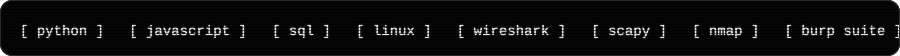

 

  

  

### About me

I am a Digital Forensics and Cybersecurity student at TU Dublin, in my second year. Security is my course, but I spend most of my free time building software and AI tools in Python. I like projects that start with a real problem, break the first time, and end up working properly.

| Cybersecurity and forensics | AI and machine learning | Software development |
| :-- | :-- | :-- |
| Reading packet captures to work out what really happened, building honeypots, and spotting odd network behaviour | LLM agents, generative AI, and models that predict outcomes from data | Python tools, APIs and web projects that are built to be used, with clean, tested code |

### Toolbox

### Projects

| Project | What it does | Built with |
| :-- | :-- | :-- |
| [**HoneyHome**](https://github.com/fuyadislam/honeyhome) | A home network honeypot with an AI security analyst you talk to on Alexa+. Decoy devices catch intruders, every event is sealed in a tamper-proof evidence log, and you get alerts by voice and text. Built for the Build, Ship, Shape Amazon Developer Hackathon | Python, MCP, Amazon Bedrock, Polly, SNS |
| [**Attack-Defense Agent**](https://github.com/tausif112/attack-defense-agent) | Two AI agents face off: the attacker plans a break-in from recon to data theft, and the defender writes countermeasures for every stage | Python, LangGraph, Groq, Llama 3.3 70B, Streamlit |
| [**Packet Logger**](https://github.com/fuyadislam/Packet-Logger) | Captures live or recorded traffic and exports JSONL, CSV and PCAP. Redesigned to stream data, cutting memory from 865 MB to 87 MB on 100,000 packets | Python, Scapy, Wireshark |
| [**Network Traffic Analysis and Anomaly Detection**](https://github.com/fuyadislam/Network-Traffic-Analysis-Anomaly-Detection) | Flags unusual traffic with rolling windows, EWMA and z-scores, tuned with a 3,125-combination grid search | Python |
| [**Formula 1 Race Prediction**](https://github.com/fuyadislam/formula_1_prediction) | Simulates 10,000 race weekends in under a second to estimate win, podium and pole chances for every driver | Python |
| [**3D Portfolio**](https://github.com/fuyadislam/fuyad-portfolio) | My personal site: a scroll-driven 3D page | HTML, CSS, JavaScript, Three.js |

### Right now

- Year 2 of BSc (Hons) Digital Forensics and Cybersecurity at TU Dublin
- Studying Scripting for Cyber Security, Network Security and Security Administration
- Treasurer of the ISoc at TU Dublin Blanchardstown and a Peer Mentor
- Looking for internships in cybersecurity, software engineering and AI

### Certificates

- Mastercard Cybersecurity Job Simulation (Forage, Jun 2026)
- Technical Support Fundamentals (Google, Oct 2025)
- Introduction to Generative AI (Google, Nov 2024)

 
fuyad/os 2.0, running somewhere between Dublin and a packet capture.

